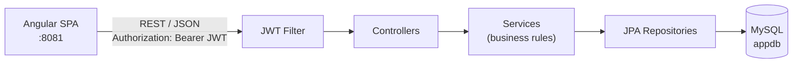
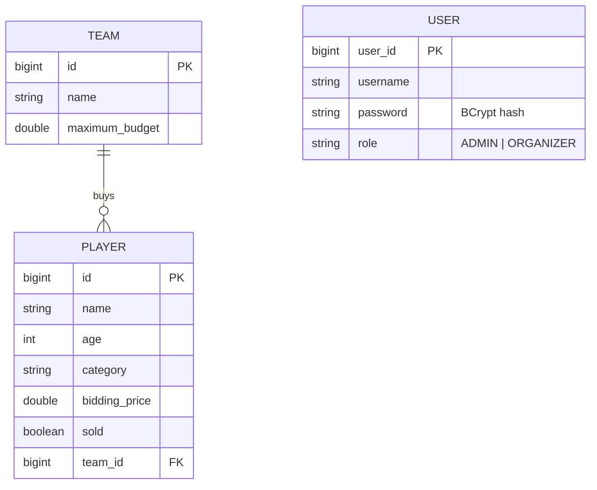

<div align="center">

# Auction League

**A full-stack cricket player auction platform with budget-safe bidding, role-based dashboards and JWT authentication.**


</div>

---

## Table of Contents

- [Overview](#overview)
- [Features](#features)
- [Tech Stack](#tech-stack)
- [Architecture](#architecture)
- [Project Structure](#project-structure)
- [Getting Started](#getting-started)
- [Configuration](#configuration)
- [API Reference](#api-reference)
- [Security](#security)
- [Testing](#testing)
- [Troubleshooting](#troubleshooting)
- [Roadmap](#roadmap)
- [License](#license)

---

## Overview

Auction League digitises a cricket player auction. An **Admin** sets up franchises (teams) with a fixed purse and builds the player pool. An **Organizer** runs the live auction, selling players to teams. The core business rule is enforced on the server: **a team can never spend beyond its maximum budget**, and a player can never be sold twice.

The domain maps naturally onto a banking ledger — a team's budget behaves like a credit limit, a sale is a debit, and releasing a player is a reversal.

## Features

### Admin dashboard
- Create, edit and delete **teams** (name, maximum budget) and **players** (name, age, category, bidding price).
- KPI strip computed from live data: teams and combined budget, players and unsold count, percentage sold, total spent.
- Searchable, filterable tables with loading, empty, no-results and error states.
- Validation that mirrors the backend rules (age 15–50, positive prices, budget not below amount already spent).
- Confirmation before destructive actions; deleting a team returns its players to the unsold pool.

### Auction room (organizer)
- Unsold players with category filters (with counts) and search.
- Per-player team selector showing each team's remaining purse; teams that can't afford the player are disabled.
- One sale in flight at a time — no accidental double submissions.
- Team purses with progress meters and expandable squads; release a player back into the pool.

### Platform
- Registration and login with role selection, live password-rule checklist and clear error messages.
- JWT-based sessions with automatic logout on token expiry and multi-tab sync.
- Role-based route guards, 403 and 404 pages.
- Responsive design (tables collapse into cards on mobile), toast notifications, keyboard-accessible modals.

## Tech Stack

| Layer | Technology |
| --- | --- |
| Frontend | Angular 16, TypeScript 5.1, RxJS, template-driven forms |
| UI | Bootstrap 5.3, Bootstrap Icons, custom design system |
| Backend | Spring Boot 3.0.1 (Web, Data JPA, Security, Validation), Java 17, Lombok |
| Authentication | JWT (jjwt 0.11.5, HS256), BCrypt password hashing |
| Database | MySQL 8 via Hibernate |
| API docs | springdoc OpenAPI / Swagger UI |
| Tooling | Maven Wrapper, Angular CLI, Karma + Jasmine, JUnit 5 + MockMvc |

## Architecture



The backend follows a layered design — **Controller → Service → Repository** — with business rules (budget checks, duplicate-sale prevention) kept in the service layer and errors mapped to HTTP responses by a global exception handler.

**Data model**



## Project Structure

```text
.
├── springapp/                      # Spring Boot backend
│   ├── pom.xml
│   ├── mvnw, mvnw.cmd, .mvn/       # Maven Wrapper
│   └── src/
│       ├── main/java/com/examly/springapp/
│       │   ├── configuration/      # Security, CORS, password encoder
│       │   ├── controller/         # REST endpoints
│       │   ├── dto/                # LoginRequest, AuthResponse
│       │   ├── entity/             # User, Team, Player
│       │   ├── exception/          # Custom exceptions + global handler
│       │   ├── repository/         # Spring Data JPA repositories
│       │   ├── security/           # JWT utility, filter, UserDetails
│       │   └── service/            # Interfaces + implementations
│       ├── main/resources/application.properties
│       └── test/                   # JUnit + MockMvc tests
│
└── angularapp/                     # Angular frontend
    ├── package.json
    ├── angular.json
    └── src/
        ├── styles.css              # Global design system
        └── app/
            ├── routing/            # Routes + guards
            ├── models/             # TypeScript interfaces
            ├── services/           # HTTP, auth, interceptor, guard, toast, confirm
            ├── shared/             # Toast + confirm dialog components, UI helpers
            └── home/ login/ registration/ navbar/
                admin/ team/ player/ organizer/ error/
```

## Getting Started

### Prerequisites

| Tool | Version |
| --- | --- |
| JDK | 17 |
| Node.js | 18 or 20 (Angular 16 officially supports 16/18; 20 works with an engine warning) |
| npm | 9+ |
| MySQL | 8.x, running on `localhost:3306` |

Maven does not need to be installed — the project ships with the Maven Wrapper.

### 1. Clone

Copy the repository URL from the green **Code** button on GitHub, then:

```bash
git clone <repository-url>
cd <repository-folder>
```

### 2. Database

Start MySQL. The database `appdb` is created automatically on first run (`createDatabaseIfNotExist=true`) and tables are generated by Hibernate. Update the credentials in `springapp/src/main/resources/application.properties` if yours differ from the defaults (`root` / `examly`).

### 3. Backend — http://localhost:8080

```bash
cd springapp
./mvnw spring-boot:run          # Windows: mvnw.cmd spring-boot:run
```

### 4. Frontend — http://localhost:8081

```bash
cd angularapp
npm install
npm start
```

Open **http://localhost:8081**, register one **Admin** and one **Organizer** account, and log in.

> The frontend resolves the API address at runtime (`src/app/services/api.config.ts`): when served from `localhost:8081` it calls `http://localhost:8080/api` automatically. No environment file needs editing for local development.

### Production build

```bash
cd angularapp && npx ng build          # output: angularapp/dist/angularapp
cd springapp  && ./mvnw clean package  # output: springapp/target/*.jar
java -jar springapp/target/springapp-0.0.1-SNAPSHOT.jar
```

## Configuration

Key settings in `springapp/src/main/resources/application.properties`:

| Property | Default | Description |
| --- | --- | --- |
| `server.port` | `8080` | API port |
| `spring.datasource.url` | `jdbc:mysql://localhost/appdb?createDatabaseIfNotExist=true` | Database connection |
| `spring.datasource.username` / `password` | `root` / `examly` | Database credentials |
| `spring.jpa.hibernate.ddl-auto` | `update` | Schema auto-update (use `validate` in production) |
| `spring.jpa.show-sql` | `true` | Log generated SQL |
| `jwt.secret` | *(set in file)* | HMAC-SHA256 signing key |
| `jwt.expiration-ms` | see file | Token lifetime in milliseconds (`3600000` = 1 hour) |

> **Do not commit real secrets.** For any shared or deployed environment, supply the database password and JWT secret through environment variables, e.g. `spring.datasource.password=${DB_PASSWORD}` and `jwt.secret=${JWT_SECRET}`.

## API Reference

Base URL: `http://localhost:8080/api` · Interactive docs: `http://localhost:8080/swagger-ui/index.html`

### Authentication

| Method | Endpoint | Body | Success | Errors |
| --- | --- | --- | --- | --- |
| `POST` | `/user/register` | `{ "username", "password", "role" }` | `200` user (password omitted) | `400` validation, `409` username taken |
| `POST` | `/user/login` | `{ "username", "password" }` | `200 { token, username, role }` | `400`, `401` invalid credentials |
| `GET` | `/user` | — | `200` list of users | — |

### Teams

| Method | Endpoint | Description |
| --- | --- | --- |
| `GET` | `/team` | List teams |
| `GET` | `/team/{teamId}` | Get a team |
| `POST` | `/team` | Create `{ "name", "maximumBudget" }` |
| `PUT` | `/team/{teamId}` | Update a team |
| `DELETE` | `/team/{teamId}` | Delete a team (its players return to the unsold pool) |

### Players

| Method | Endpoint | Description |
| --- | --- | --- |
| `GET` | `/player` | List players |
| `GET` | `/player/{playerId}` | Get a player |
| `POST` | `/player` | Create `{ "name", "age", "category", "biddingPrice", "sold" }` |
| `PUT` | `/player/{playerId}` | Update a player |
| `DELETE` | `/player/{playerId}` | Delete a player |

### Auction

| Method | Endpoint | Description | Errors |
| --- | --- | --- | --- |
| `POST` | `/organizer/assign-player?playerId={id}&teamId={id}` | Sell a player to a team | `400` exceeds team budget, `409` already sold |
| `GET` | `/organizer/unsold-players` | Players not yet sold | — |
| `GET` | `/organizer/sold-players` | Players sold | — |
| `PUT` | `/organizer/release-player/{playerId}` | Return a player to the pool | — |
| `GET` | `/organizer/player-list/{teamId}` | A team's squad | — |

### Example

```bash
# Log in
curl -X POST http://localhost:8080/api/user/login \
  -H "Content-Type: application/json" \
  -d '{"username":"admin1","password":"Admin@123"}'

# Use the returned token
curl http://localhost:8080/api/team \
  -H "Authorization: Bearer <token>"
```

## Security

| Concern | Implementation |
| --- | --- |
| Password storage | BCrypt (salted, cost factor 10); the password field is write-only in JSON and never returned |
| Authentication | Credentials verified by Spring Security's `AuthenticationManager`; identical error message for unknown user and wrong password |
| Session | Stateless JWT signed with HS256, carrying username, role, issued-at and expiry |
| Request auth | Angular `HttpInterceptor` attaches `Authorization: Bearer <token>`; `JwtAuthenticationFilter` validates signature and expiry |
| Authorization (UI) | `AuthGuard` restricts `/admin` to ADMIN and `/organizer` to ORGANIZER |
| Session hygiene | Frontend logs out automatically on token expiry and syncs logout across tabs |
| Data integrity | Duplicate usernames rejected (`409`); bean validation on all entities; global exception handler returns clean status codes |
| CORS / CSRF | CORS configured for the Angular client; CSRF disabled because authentication uses a header token, not cookies |

### Known limitations

- **API-level authorization is open.** `SecurityConfig` currently uses `permitAll()` so that the automated grading tests, which call the API without a token, can run. Role checks are enforced in the Angular app only. For any real deployment, restrict endpoints with `hasRole(...)` rules and register the JWT filter in the security chain (`addFilterBefore`).
- CORS allows all origins — restrict to the deployed frontend domain in production.
- The JWT is stored in `localStorage`; no refresh tokens or server-side revocation.
- Anyone can register as ADMIN; production would require admin approval or provisioning.

## Testing

```bash
# Backend (requires MySQL running)
cd springapp && ./mvnw test

# Frontend (headless Chrome)
cd angularapp && npm test
```

The backend suite uses JUnit 5 and MockMvc against the real database. The frontend suite uses Karma and Jasmine.

To skip Puppeteer's Chromium download during `npm install`:

```bash
PUPPETEER_SKIP_DOWNLOAD=true npm install
```

## Troubleshooting

| Problem | Fix |
| --- | --- |
| `Communications link failure` on backend start | MySQL is not running, or the credentials in `application.properties` are wrong |
| Frontend shows "Cannot reach the server" | Start the backend on port 8080 first |
| CORS error in the browser console | Confirm the backend is running and check the server log — a 500 response without CORS headers also appears as a CORS error |
| Login fails for an existing account | Accounts created before duplicate-username protection may exist twice; remove the duplicate row from the `user` table |
| `npm install` engine warning on Node 20 | Safe to ignore, or use Node 18 |

## Roadmap

- [ ] Enforce role-based authorization on the API (`hasRole`, method security)
- [ ] Short-lived access tokens with refresh-token rotation
- [ ] Optimistic locking (`@Version`) to prevent concurrent sale of the same player
- [ ] DTOs and mappers instead of exposing JPA entities
- [ ] `BigDecimal` for monetary values
- [ ] Unified error response format (`ProblemDetail`)
- [ ] Server-side pagination and filtering
- [ ] Audit trail for sales and releases
- [ ] Live bidding over WebSockets
- [ ] Docker Compose for one-command setup

## License

This project is licensed under the [MIT License](LICENSE).

---

<div align="center">
Built with Spring Boot and Angular.
</div>
